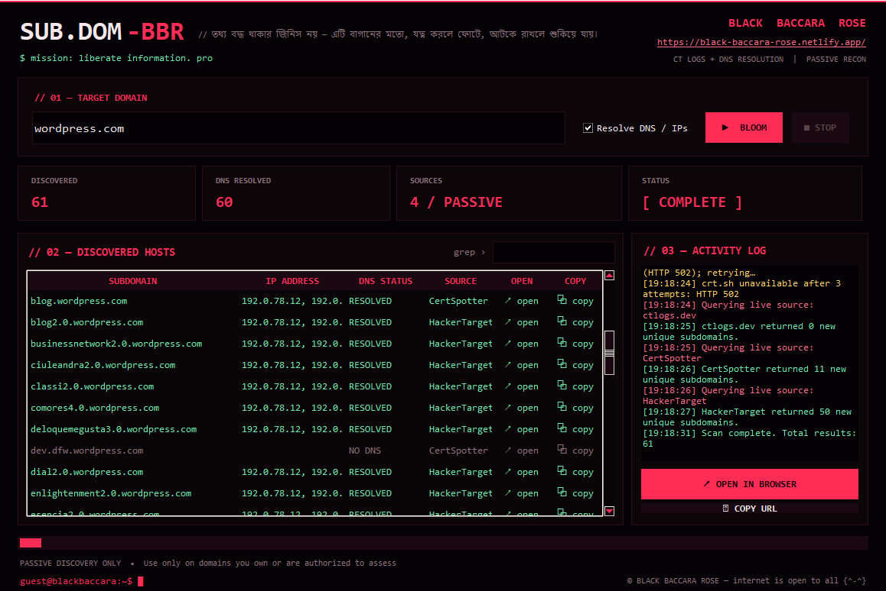

<div align="center">


# SUB.DOM**-BBR**

### `root@blackbaccara: sudo bloom --force`

**Passive subdomain finder with a dark-rose terminal GUI.**
*তথ্য বদ্ধ থাকার জিনিস নয় — এটি বাগানের মতো, যত্ন করলে ফোটে, আটকে রাখলে শুকিয়ে যায়।*


[**Official site**](https://black-baccara-rose.netlify.app/) · [**Report an issue**](../../issues)

</div>

---

## `// 00 — preview`

<div align="center">

</div>

---

## `// 01 — what is this`

**SUB.DOM-BBR** finds subdomains of a domain using **public, passive sources** (certificate transparency logs and open APIs), then optionally resolves each host to its IP address. Results appear in a live table you can filter, open in your browser, copy, and export.

It is a single Python file. No `pip install`, no API keys.

```text
$ whoami
black_baccara_collective

$ cat mission.txt
liberate information.
protect the fragile.
bloom in the dark.
```

---

## `// 02 — features`

| | Feature |
|---|---|
| 🌹 | Queries **4 passive sources**: `crt.sh`, `ctlogs.dev`, `CertSpotter`, `HackerTarget` |
| 🌹 | Automatic **retry with backoff** when a source is down or rate-limited |
| 🌹 | Optional **DNS / IP resolution** for every discovered host |
| 🌹 | **One-click open** in browser (`↗ open`) and **one-click copy** of the full URL (`⧉ copy`) |
| 🌹 | **Right-click menu**: open in browser, copy URL, copy subdomain |
| 🌹 | **Multi-select** rows, then open or copy them all (confirms before opening more than 5 tabs) |
| 🌹 | Live **`grep ›` filter** across subdomain, IP, status and source |
| 🌹 | Resolved hosts shown in green, `NO DNS` hosts dimmed |
| 🌹 | **Export** to CSV or TXT, plus **copy all** to clipboard |
| 🌹 | Activity log, **Stop** button, authorization prompt before every scan |

---

## `// 03 — install & run`

**Requirements:** Python 3.8 or newer. Tkinter ships with Python on Windows and macOS.

```bash
# 1. get the tool
git clone https://github.com/black-baccara-rose/SUB.DOM-BBR.git
cd SUB.DOM-BBR

# 2. run it
python SUB.DOM-BBR.py
```

On Linux, install Tkinter first if it is missing:

```bash
sudo apt install python3-tk      # Debian / Ubuntu / Kali
sudo dnf install python3-tkinter # Fedora
```

---

## `// 04 — usage`

1. Type a domain, for example `example.com`. URLs such as `https://example.com/` and wildcards like `*.example.com` are cleaned automatically.
2. Leave **Resolve DNS / IPs** ticked if you want IP addresses.
3. Press **▶ BLOOM** (or hit `Enter`) and confirm the authorization prompt.
4. Watch the table fill. Use the **grep** box to filter.
5. Click `↗ open` to visit a host, `⧉ copy` to copy its URL, or select rows and use the side-panel buttons.
6. Export with **EXPORT CSV** or **EXPORT TXT**.

| Action | How |
|---|---|
| Open host in browser | Click `↗ open`, or double-click the subdomain |
| Copy URL | Click `⧉ copy` |
| More options | Right-click a row |
| Select many | `Ctrl` / `Shift` + click, then use the side-panel buttons |

Exports are named `SUB.DOM-BBR_<domain>.csv` / `.txt`.

---

## `// 05 — how it works`

```text
 target domain
      │
      ├──► crt.sh ───────┐
      ├──► ctlogs.dev ───┤
      ├──► CertSpotter ──┼──► de-duplicate ──► validate hostnames ──► DNS resolve (optional) ──► table
      └──► HackerTarget ─┘
```

The tool never port-scans, brute-forces or sends traffic to the target's web services. It reads public certificate and host data, and the optional resolve step performs ordinary DNS lookups for the names it found.

---

## `// 06 — troubleshooting`

| Problem | Why / fix |
|---|---|
| `crt.sh unavailable ... HTTP 502` | crt.sh is often overloaded. The tool retries 3 times, and the other sources still run. Try again later for more complete results. |
| `All live API sources failed` | Check your internet, firewall, DNS or VPN. |
| Few or no results | Public sources have rate limits and limited coverage. **No result does not prove no subdomains exist.** |
| `ModuleNotFoundError: tkinter` | Install Tkinter, see the Linux commands above. |

---

## `// 07 — responsible use`

> **Use this tool only on domains you own or are explicitly authorized to assess.**

We find, understand and protect. We don't destroy. You are responsible for how you use this software, and for following the laws and the terms of service of the data sources it queries. The authors accept no liability for misuse.

---

## `// 08 — credits`

**Made by [Black Baccara Rose](https://black-baccara-rose.netlify.app/)**
Official link: https://black-baccara-rose.netlify.app/

Data sources: [crt.sh](https://crt.sh) · [ctlogs.dev](https://ctlogs.dev) · [CertSpotter](https://sslmate.com/certspotter/) · [HackerTarget](https://hackertarget.com)

---

<div align="center">

```text
guest@blackbaccara:~$ █
```

**© BLACK BACCARA ROSE — internet is open to all {^-^}**

</div>
